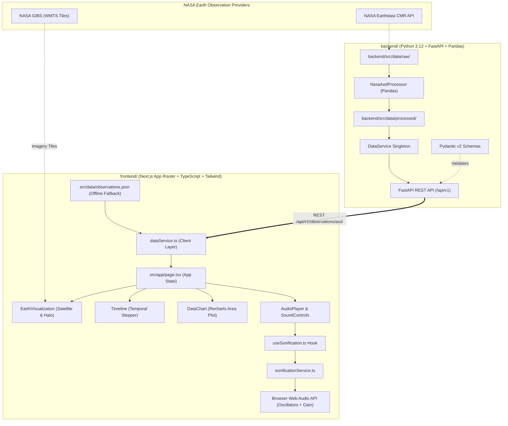

# BREATHE – System Architecture

This document describes the decoupled architectural foundation of **BREATHE**, detailing the separation of concerns between the **Next.js Frontend** and the **Python FastAPI Backend**, their communication interfaces, and ownership across the 6 hackathon workstreams.

---

## 1. High-Level Architectural Diagram



---

## 2. Directory Structure

```text
BREATHE-EarthJukebox/
├── frontend/                   # Frontend Client (Next.js, React, Web Audio)
│   ├── public/                 # Static imagery, icons, audio samples
│   ├── src/
│   │   ├── app/                # App Router (page.tsx, layout.tsx, globals.css)
│   │   ├── components/         # Layout, visualization, audio, science
│   │   ├── hooks/              # useSonification hook
│   │   ├── services/           # dataService.ts, sonificationService.ts
│   │   ├── types/              # observation.ts, dataset.ts, audio.ts
│   │   ├── data/               # observations.json (Mock data fallback)
│   │   └── lib/                # Shared utilities (formatters, interpolators)
│   ├── package.json
│   ├── tsconfig.json
│   ├── next.config.mjs
│   ├── tailwind.config.ts
│   └── README.md
│
├── backend/                    # Scientific Backend (FastAPI, Pandas)
│   ├── src/
│   │   ├── api/
│   │   │   ├── routes/         # /health, /observations/aod
│   │   │   └── schemas/        # observation_schema.py (Pydantic models)
│   │   ├── services/           # data_service.py
│   │   ├── processors/         # nasa_aod_processor.py (Pandas cleaning)
│   │   ├── data/
│   │   │   ├── raw/            # Ingested NASA raw files
│   │   │   └── processed/      # Normalized datasets (aod_nasa_processed.json)
│   │   ├── utils/              # Structured logger
│   │   └── main.py             # FastAPI entrypoint & CORS
│   ├── tests/                  # Pytest test suite
│   ├── scripts/                # fetch_nasa_data.py ingestion CLI
│   ├── requirements.txt
│   └── README.md
│
├── docs/                       # Shared Documentation & Contracts
│   ├── PROJECT_OVERVIEW.md     # Vision & user journey
│   ├── ARCHITECTURE.md         # This document
│   ├── SRS.md                  # Software Requirements Specification (IEEE 830)
│   ├── DATA_CONTRACT.md        # Observation & Dataset schema
│   ├── SONIFICATION_CONTRACT.md# Audio mapping & lifecycle specs
│   ├── TEAM_TASKS.md           # 24-hour sprint task breakdown
│   └── CONTRIBUTING.md         # Git conventions & file ownership
│
├── .editorconfig
├── .gitignore
├── .env.example
└── README.md
```

---

## 3. Workstream Decoupling & Module Ownership

| Workstream | Role | Primary Directory | Ownership Rules |
| :--- | :--- | :--- | :--- |
| **N01 – Data Engineering** | NASA Earthdata retrieval, data cleaning, API delivery | `backend/` | Owns Python scripts, processors, schemas, and endpoints. |
| **N02 – Scientific Research** | Variable definition, physical accuracy, units | `docs/`, `backend/src/processors/` | Validates AOD $\ne$ AQI, verifies measurement units. |
| **N03 – Sonification** | Web Audio API synthesizer, tone transfer functions | `frontend/src/services/sonificationService.ts`, `hooks/` | Controls audio synthesis exclusively on client side. |
| **N04 – Frontend Development** | Main layout, timeline, charts, UI reactivity | `frontend/src/` | Connects UI components to `dataService` and audio hooks. |
| **N05 – UI/UX & Storytelling** | Visual identity, NASA imagery curation, styling | `frontend/public/`, `src/app/` | Curates visual textures and theme aesthetics. |
| **N06 – Integration & QA** | System integration, cross-module testing, review | Root configs, `docs/` | Enforces contracts, verifies PRs, oversees submission. |

---

## 4. Communication & Integration Protocol

1. **Protocol:** REST over HTTP/JSON.
2. **CORS:** The FastAPI backend authorizes cross-origin requests from `http://localhost:3000`.
3. **Resilience / Fallback:**
   - The frontend's `dataService.ts` queries `GET http://localhost:8000/api/v1/observations/aod`.
   - If the backend is active, live/processed observations are displayed seamlessly.
   - If the backend is unreachable or not started, the frontend falls back silently to `frontend/src/data/observations.json`, ensuring the UI never fails during live judging or offline testing.
4. **Data Contract Consistency:**
   - Frontend TypeScript `Observation` interface matches Backend Pydantic `ObservationSchema`.
   - Frontend TypeScript `Dataset` interface matches Backend Pydantic `DatasetSchema`.
