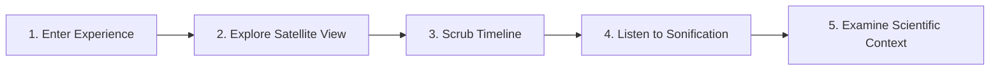

# BREATHE – Project Overview

> **Tagline:** *Hear what the atmosphere is telling us.*  
> **Challenge:** NASA Space Apps Challenge 2026 – The Earth Information Jukebox  
> **Team:** 6-Person Hackathon Team (Workstreams N01 – N06)  
> **Target:** 24-Hour Hackathon MVP Foundation  

---

## 1. Executive Summary & Concept

**BREATHE** transforms NASA Earth observations and atmospheric science data into an interactive, synchronized audiovisual experience. While visual dashboards display satellite imagery and time-series plots, human auditory cognition offers high temporal resolution and pattern recognition capable of perceiving complex shifts in atmospheric density, dispersion, and turbidity.

By pairing traceable NASA satellite observations with data-driven acoustic sonification via the Web Audio API, BREATHE empowers users to:
1. **Explore NASA Earth Information Center visualizations** across global and regional atmospheric events.
2. **Navigate observations across historical and real-time timestamps** using an intuitive temporal scrubber.
3. **Listen to atmospheric dynamics** through frequency, timbre, and harmonic sound mapping.
4. **Compare observations** to recognize clean maritime baselines versus heavy biomass burning or dust plumes.
5. **Understand the scientific rationale** behind atmospheric variables, observation instruments, and sonification translations.

---

## 2. Core Scientific Integrity & Principles

### A. Aerosol Optical Depth (AOD) is NOT Air Quality Index (AQI)
- **Aerosol Optical Depth (AOD)** is a dimensionless measure of total solar irradiance extinction (scattering and absorption) caused by suspended aerosols across the *entire vertical atmospheric column* (from Earth's surface to the top of the atmosphere).
- **Air Quality Index (AQI)** is a public health metric based on ground-level concentrations of surface pollutants (PM2.5, PM10, O3, NO2, SO2, CO) measured at ground monitoring stations.
- **Scientific Rule:** AOD measurements must **never** be labeled, reported, or conflated with AQI. A heavy wildfire smoke plume traveling at 6 km altitude produces very high column AOD while ground-level sensors beneath the boundary layer inversion may detect clean air.

### B. Traceable Data Provenance
- All verified data points must originate from accredited NASA missions (e.g., MODIS aboard Terra and Aqua, VIIRS aboard Suomi NPP and NOAA-20, or OCO-2/3).
- Data points must include ISO 8601 UTC timestamps, observation variables, physical units, sensor details, and traceable catalog links.

### C. Explicit Demarcation of Mock vs. Verified Data
- Synthetic development data is flagged with `isMock: true`.
- Mock values must never be attributed to NASA or portrayed as verified scientific measurements.

---

## 3. User Journey & Core Interactions

1. **Orientation:** User lands on dark-theme atmospheric cockpit with Earth visualization and live status badges.
2. **Observation Selection:** User clicks timestamps or steps forward/backward across observation events.
3. **Audiovisual Synchronization:** The visual atmospheric halo, measurement telemetry HUD, time-series chart cursor, and Web Audio synthesizer pitch update synchronously.
4. **Parameter Exploration:** User adjusts acoustic volume, waveform types, and harmonic overtone layers to hear how aerosol load alters acoustic complexity.
5. **Scientific Learning:** User unfolds context panels detailing sensor instrumentation and sonification mapping logic.

---

## 4. Technology Stack

- **Frontend Framework:** Next.js (App Router, React, TypeScript)
- **Styling & Design System:** Tailwind CSS (custom dark space/atmospheric palette)
- **Iconography:** Lucide React
- **Data Visualization:** Recharts
- **Audio Synthesizer:** Native HTML5 Web Audio API
- **Data Format:** Strongly typed JSON / CSV
- **Architecture Paradigm:** Unidirectional data flow, modular service-oriented architecture
