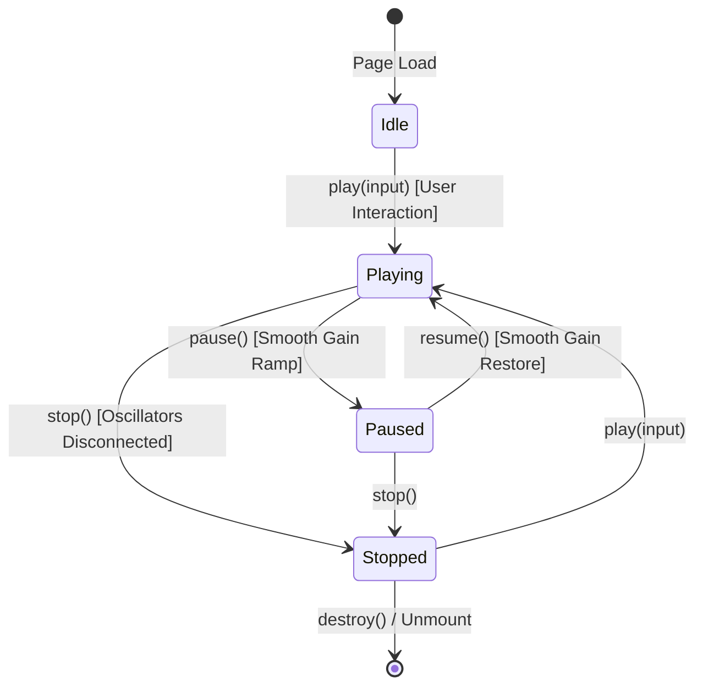

# BREATHE – Sonification Contract

> **Primary Owners:** N03 (Sonification) & N02 (Scientific Research)  
> **Interface Consumers:** N04 (Frontend Development)  
> **Status:** Stable Interface Baseline (v1.0.0)

---

## 1. Overview

The sonification subsystem transforms atmospheric physical measurements into acoustic output using the browser's native **Web Audio API**. This contract defines the data payloads, audio lifecycle states, acoustic mapping algorithms, and synchronization rules between the frontend timeline and the audio engine.

---

## 2. Shared Types and Signatures

Defined in [src/types/audio.ts](file:///d:/explode/BREATHE-EarthJukebox/src/types/audio.ts):

### SonificationInput
```typescript
export interface SonificationInput {
  /** Numeric observation value to sonify */
  value: number;

  /** Minimum reference value in current dataset range */
  min: number;

  /** Maximum reference value in current dataset range */
  max: number;

  /** Observation timestamp */
  timestamp: string;
}
```

### PlaybackState
```typescript
export type PlaybackState =
  | "idle"
  | "playing"
  | "paused"
  | "stopped";
```

### SonificationConfig
```typescript
export interface SonificationConfig {
  minFrequencyHz: number;      // Baseline frequency (e.g. 130.81 Hz - C3)
  maxFrequencyHz: number;      // Peak frequency (e.g. 523.25 Hz - C5)
  volume: number;              // Master gain (0.0 - 1.0)
  waveform: "sine" | "triangle" | "sawtooth" | "square";
  enableHarmonics: boolean;    // Secondary overtone layer for turbidity
}
```

---

## 3. Data-to-Sound Mapping Mathematics

### Normalized Observation Value ($N$)
Given observation value $V \in [V_{\min}, V_{\max}]$:

$$N = \frac{\text{clamp}(V, V_{\min}, V_{\max}) - V_{\min}}{V_{\max} - V_{\min}}$$

### Target Fundamental Frequency ($f_0$)
Linear acoustic mapping maps $N \in [0, 1]$ across the musical frequency spectrum:

$$f_0 = f_{\min} + N \cdot (f_{\max} - f_{\min})$$

*Default Configuration:* $f_{\min} = 130.81\text{ Hz}$ ($\text{C}_3$), $f_{\max} = 523.25\text{ Hz}$ ($\text{C}_5$).

### Secondary Harmonic Overtone ($f_{\text{harmonic}}$)
When `enableHarmonics = true`, a secondary triangle oscillator generates an overtone at a musical interval (Perfect Fifth, $1.5 \times f_0$) with gain scaled to turbidity ($0.3 \times \text{masterGain}$), representing diffuse solar scattering in high-aerosol conditions.

---

## 4. Web Audio Lifecycle & Memory Rules

To comply with browser autoplay restrictions and prevent audio clicks or resource exhaustion:



1. **User Gesture Requirement:** The `AudioContext` is never activated until the user interacts with the UI.
2. **Smooth Gain Ramping:** Never abruptly set gain values to 0 or 1. Use `exponentialRampToValueAtTime()` or `setTargetAtTime()` with a 40–80 ms ramp to eliminate clicking transients.
3. **Resource Teardown:** When stopping or switching tracks, `oscillator.stop()` and `gain.disconnect()` must be called to allow garbage collection.

---

## 5. Synchronization Contract with Frontend (N04)

- When the user steps forward or backward on the timeline while playback is active, `AudioPlayer` passes the updated `SonificationInput` into `sonificationService.play(input)`.
- The service dynamically schedules frequency glide without stopping the oscillator:
  ```typescript
  oscillator.frequency.exponentialRampToValueAtTime(targetFreq, now + 0.08);
  ```
- Real-time telemetry (`currentFrequencyHz`, `normalizedValue`) is broadcast via `onTelemetry()` listeners so UI meters and visualizations update seamlessly.
