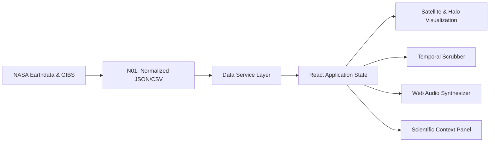

# SOFTWARE REQUIREMENTS SPECIFICATION (SRS)
## Project: BREATHE – Earth Information Jukebox
### NASA Space Apps Challenge 2026

---

**Document Identifier:** BREATHE-SRS-2026-V1.0  
**Current Status:** Approved Baseline  
**Revision:** 1.0.0  
**Date:** November 14, 2026  
**Authors / Roles:**
- Lead Architect & Frontend Lead (N04/N06)
- Scientific Research Lead (N02)
- Data Engineering Lead (N01)
- Sonification Systems Lead (N03)
- UI/UX & Creative Lead (N05)

---

## TABLE OF CONTENTS
1. [Introduction](#1-introduction)
   - 1.1 Purpose
   - 1.2 Document Conventions
   - 1.3 Intended Audience
   - 1.4 Project Scope
   - 1.5 References
2. [Overall Description](#2-overall-description)
   - 2.1 Product Perspective & Context
   - 2.2 Product Functions Overview
   - 2.3 User Classes and Personas
   - 2.4 Operating Environment
   - 2.5 Design & Technical Constraints
   - 2.6 Assumptions and Dependencies
3. [External Interface Requirements](#3-external-interface-requirements)
   - 3.1 User Interfaces (UI/UX)
   - 3.2 Hardware Interfaces
   - 3.3 Software & API Interfaces
   - 3.4 Communications Interfaces
4. [System Features & Functional Requirements](#4-system-features--functional-requirements)
   - 4.1 System Feature 1: Earth Observation Imagery & Spatial Visualization
   - 4.2 System Feature 2: Temporal Scrubber & Observation Sequencer
   - 4.3 System Feature 3: Web Audio Dynamic Sonification Synthesizer
   - 4.4 System Feature 4: Time-Series Telemetry & Interactive Charting
   - 4.5 System Feature 5: Scientific Integrity & Physical Demarcation
   - 4.6 System Feature 6: Data Provenance & Traceability System
   - 4.7 System Feature 7: Educational Scientific Breakdown Panel
5. [Non-Functional Requirements (NFR)](#5-non-functional-requirements-nfr)
   - 5.1 Performance & Latency Requirements
   - 5.2 Auditory Safety & Hearing Protection
   - 5.3 Reliability & Browser Autoplay Compliance
   - 5.4 Accessibility & Multimodal Ergonomics (WCAG 2.1 AA)
   - 5.5 Scientific Rigor & Data Attribution
   - 5.6 Security & Environment Isolation
6. [Data Model & Sonification Architecture](#6-data-model--sonification-architecture)
   - 6.1 Data Schema Specifications
   - 6.2 Sonification Mathematical Transfer Function
7. [Verification, Traceability & Acceptance](#7-verification-traceability--acceptance)
   - 7.1 Requirements Traceability Matrix (RTM)
   - 7.2 Hackathon Acceptance Criteria

---

## 1. INTRODUCTION

### 1.1 Purpose
This Software Requirements Specification (SRS) establishes the complete functional, non-functional, scientific, and architectural requirements for **BREATHE**, an interactive Earth science sonification web application built for the **NASA Space Apps Challenge 2026 – The Earth Information Jukebox**.

This document serves as the single source of truth for the 6 specialized workstreams (N01 Data Engineering, N02 Scientific Research, N03 Sonification, N04 Frontend, N05 UI/UX & Storytelling, N06 Integration/QA) working under a 24-hour sprint deadline.

### 1.2 Document Conventions
- **MUST / SHALL:** Mandatory requirement. Failure to meet these criteria constitutes non-compliance.
- **SHOULD:** Highly recommended requirement. Must be prioritized unless blocked by hackathon time constraints.
- **MAY:** Optional or stretch-goal capability (Priority P2).
- **AOD:** Aerosol Optical Depth at 550 nm (dimensionless physical property).
- **AQI:** Air Quality Index (surface-level regulatory public health index).
- **ISO 8601:** International standard for timestamp representation (`YYYY-MM-DDTHH:mm:ssZ`).

### 1.3 Intended Audience
- **Hackathon Judges & Evaluators:** Evaluating alignment with the NASA challenge statement, scientific fidelity, accessibility, and technical elegance.
- **Development Team (Workstreams N01–N06):** Implementing data ingestion, Web Audio synthesis, UI layout, and scientific storytelling.
- **Scientific Peer Reviewers:** Verifying that physical quantities and units are portrayed accurately.

### 1.4 Project Scope
BREATHE translates NASA satellite observations of the Earth's atmosphere into an intuitive, synchronized audiovisual jukebox. By translating column optical depth, gas concentrations, and climate shifts into musical pitch and timbral density, BREATHE expands human sensory bandwidth for understanding complex Earth system dynamics.

*Out of Scope for MVP:* Multi-user collaboration, persistent user accounts, native mobile OS binaries, heavy backend microservices, real-time telemetry streaming from operational satellites.

### 1.5 References
1. NASA Earth Information Center (EIC): `https://earth.gov`
2. NASA Earthdata Search & CMR API: `https://cmr.earthdata.nasa.gov`
3. NASA Global Imagery Browse Services (GIBS): `https://gibs.earthdata.nasa.gov`
4. NASA Space Apps Challenge 2026: *The Earth Information Jukebox* Statement
5. W3C Web Audio API Specification (W3C Candidate Recommendation)
6. Project Contracts: [docs/DATA_CONTRACT.md](file:///d:/explode/BREATHE-EarthJukebox/docs/DATA_CONTRACT.md), [docs/SONIFICATION_CONTRACT.md](file:///d:/explode/BREATHE-EarthJukebox/docs/SONIFICATION_CONTRACT.md), [docs/ARCHITECTURE.md](file:///d:/explode/BREATHE-EarthJukebox/docs/ARCHITECTURE.md)

---

## 2. OVERALL DESCRIPTION

### 2.1 Product Perspective & Context
BREATHE is a standalone client-side single-page application (SPA) powered by Next.js App Router. It acts as an interpretive layer on top of NASA Earth Observations, combining visual telemetry with interactive sonification.



### 2.2 Product Functions Overview
1. **Satellite Exploration:** Render satellite composites with reactive atmospheric scattering halo simulations.
2. **Temporal Navigation:** Step or scrub across observation timestamps chronologically.
3. **Data-Driven Sonification:** Map optical extinction to acoustic fundamental frequencies and overtones in real time.
4. **Time-Series Analysis:** Plot measurement values over time with an active observation cursor.
5. **Acoustic Sculpting:** Allow users to adjust synthesis parameters (volume, waveform, overtone layer).
6. **Scientific Rigor & Education:** Enforce strict scientific distinctions between column AOD and surface AQI.
7. **Traceable Attribution:** Provide explicit links and citations to NASA mission sensors.

### 2.3 User Classes and Personas
- **Challenge Judge / Evaluator:** Requires instant onboarding, demonstrable technical elegance, zero scientific errors, and working end-to-end functionality within 2 minutes.
- **Climate & Science Educator:** Requires clear explanations of satellite remote sensing, verifiable citations, and student-accessible visual/auditory mappings.
- **Visually Impaired Learner:** Leverages auditory sonification to discern patterns and rates of change in atmospheric turbidity without relying solely on visual maps.
- **General Public / Science Enthusiast:** Expects an engaging, immersive aesthetic with fluid interactions and intuitive controls.

### 2.4 Operating Environment
- **Platform:** Modern Web Browsers supporting Web Audio API, ES2022, and HTML5 Canvas/SVG (Chrome 110+, Firefox 115+, Safari 16+, Edge 110+).
- **Target Form Factors:** Desktop monitors (1920x1080, 1440x900), laptops, tablets (iPad/Android), and modern smartphones (375px+ viewport width).
- **Network Mode:** Zero runtime backend required; functions entirely with local pre-bundled datasets or client-side fetches.

### 2.5 Design & Technical Constraints
1. **Autoplay Policy Constraint:** The browser Web Audio `AudioContext` must never emit sound until explicit user interaction (e.g., clicking Play) occurs.
2. **24-Hour Velocity Constraint:** Architecture must rely on modular, loosely coupled contracts to allow parallel execution across all 6 roles without merge conflicts.
3. **Zero Backend Dependency:** No external server or database required for core MVP functionality.
4. **Scientific Precision:** Column AOD must never be labeled or converted to AQI.

### 2.6 Assumptions and Dependencies
- Client browser supports HTML5 Web Audio API (`window.AudioContext` or `window.webkitAudioContext`).
- Local or CDN imagery is reachable via HTTPS.
- Pre-processed NASA datasets conform to `src/types/dataset.ts`.

---

## 3. EXTERNAL INTERFACE REQUIREMENTS

### 3.1 User Interfaces (UI/UX)
- **Visual Identity:** Deep navy space background (`#060913`, `#0B1120`), atmospheric cyan (`#06b6d4`), sky blue (`#38bdf8`), and high-contrast typography.
- **Atmospheric Glow HUD:** The Earth visualization must dynamically compute a radial gradient overlay whose opacity, spread, and hue reflect the current observation value.
- **Status Indicator Badges:**
  - Mock Mode: Amber badge (`DEVELOPMENT MOCK DATA`) with pulse animation.
  - Verified Mode: Emerald badge (`VERIFIED NASA DATA`).
- **Responsive Layout:** 12-column grid system transitioning smoothly from single-column mobile view to multi-pane desktop cockpit.

### 3.2 Hardware Interfaces
- **Audio Output:** Standard stereo headphones, internal speakers, or external audio monitors via the operating system's default sound output device.
- **Input Devices:** Mouse, trackpad, touch screen gestures (tap, drag/scrub), and standard keyboard navigation.

### 3.3 Software & API Interfaces
- **Web Audio API:** OscillatorNode, GainNode, AudioContext destination.
- **NASA GIBS WMTS Endpoint:** `https://gibs.earthdata.nasa.gov/wmts/epsg4326/best` (for verified satellite imagery tile layers).
- **NASA Earthdata CMR API:** RESTful JSON endpoints for granule and observation querying.

### 3.4 Communications Interfaces
- All network interactions must use HTTPS (TLS 1.3).
- Data files formatted in UTF-8 JSON.

---

## 4. SYSTEM FEATURES & FUNCTIONAL REQUIREMENTS

### 4.1 System Feature 1: Earth Observation Imagery & Spatial Visualization
- **FR-1.1:** The system SHALL render satellite observation imagery corresponding to the currently selected observation timestamp.
- **FR-1.2:** The system SHALL display an interactive visual atmospheric halo around the Earth visualization whose color and diffusion shift dynamically based on measurement value:
  - Value $\le 0.20$: Clean maritime air mass (cyan glow, low turbidity).
  - $0.20 <$ Value $\le 0.40$: Mild regional haze (sky blue glow).
  - $0.40 <$ Value $\le 0.80$: Moderate turbidity / smoke layer (amber glow).
  - Value $> 0.80$: Dense aerosol plume / dust storm (deep orange-red glow).
- **FR-1.3:** The system SHALL display satellite HUD metadata including coordinates (latitude, longitude), geographic region name, and sensor platform.
- **FR-1.4:** If the active dataset is synthetic, the visualizer SHALL render an explicit `MOCK VISUAL` warning pill over the image frame.

### 4.2 System Feature 2: Temporal Scrubber & Observation Sequencer
- **FR-2.1:** The system SHALL render an interactive chronological timeline containing all observations in the active dataset.
- **FR-2.2:** The user SHALL be able to select any individual observation by clicking its timeline node or stepping via "Previous" and "Next" controls.
- **FR-2.3:** The system SHALL disable the "Previous" control when the earliest observation is active and disable the "Next" control when the latest observation is active.
- **FR-2.4:** The timeline SHALL visually highlight the active step with a high-contrast cyan indicator and update a continuous progress bar.

### 4.3 System Feature 3: Web Audio Dynamic Sonification Synthesizer
- **FR-3.1:** The system SHALL convert observation measurements into audible frequencies using the browser Web Audio API without third-party audio player plugins.
- **FR-3.2:** The system SHALL map data values across the acoustic frequency range:
  - Minimum observation value $\rightarrow$ Base frequency ($130.81\text{ Hz}$ / Musical pitch $\text{C}_3$).
  - Maximum observation value $\rightarrow$ Peak frequency ($523.25\text{ Hz}$ / Musical pitch $\text{C}_5$).
- **FR-3.3:** When navigating between observations during active playback, the system SHALL execute continuous frequency gliding using `exponentialRampToValueAtTime()` with an $80\text{ ms}$ ramp time to eliminate audio clicks.
- **FR-3.4:** The system SHALL provide transport controls: Play, Pause, and Stop.
- **FR-3.5:** The system SHALL provide acoustic adjustment controls:
  - Master Gain (Volume: $0\%\text{ to }100\%$).
  - Primary Oscillator Waveform (`sine`, `triangle`, `sawtooth`, `square`).
  - Atmospheric Harmonic Overtone toggle (adds a secondary triangle overtone at $1.5\times f_0$).
- **FR-3.6:** The system SHALL maintain a synchronized state machine with 4 states: `idle`, `playing`, `paused`, `stopped`.
- **FR-3.7:** The system SHALL disconnect and tear down Web Audio nodes upon component unmount to prevent audio memory leaks.

### 4.4 System Feature 4: Time-Series Telemetry & Interactive Charting
- **FR-4.1:** The system SHALL render a time-series area plot showing measurement values across all observation timestamps.
- **FR-4.2:** The chart SHALL render an active reference line and marker locked to the timestamp of the currently selected observation.
- **FR-4.3:** Clicking any coordinate point or column in the chart SHALL immediately update the globally selected observation across the timeline, visualizer, and audio synthesizer.
- **FR-4.4:** Hovering over chart data points SHALL display a custom dark tooltip detailing the formatted UTC time, value, and scientific unit.

### 4.5 System Feature 5: Scientific Integrity & Physical Demarcation
- **FR-5.1:** Aerosol Optical Depth (AOD) measurements SHALL be explicitly labeled as dimensionless optical depth at $550\text{ nm}$.
- **FR-5.2:** The system SHALL NOT label, describe, or convert AOD measurements into Air Quality Index (AQI).
- **FR-5.3:** The application SHALL render an educational warning card explaining that column AOD measures total vertical extinction from surface to space, whereas AQI measures ground-level concentrations of breathable particulates.
- **FR-5.4:** The system SHALL distinguish between mock development data and verified NASA data through distinct visual badges and disclaimers.

### 4.6 System Feature 6: Data Provenance & Traceability System
- **FR-6.1:** Every dataset SHALL contain traceable metadata including data provider name, sensor instrument, satellite mission, and canonical source URL.
- **FR-6.2:** All observation timestamps SHALL be standardized to ISO 8601 UTC format.
- **FR-6.3:** The footer SHALL provide direct external hyperlinks to NASA Earth Information Center, NASA Earthdata, and NASA Worldview.

### 4.7 System Feature 7: Educational Scientific Breakdown Panel
- **FR-7.1:** The system SHALL provide an interactive scientific accordion covering:
  1. Satellite Remote Sensing: How MODIS and VIIRS instruments calculate aerosol optical thickness.
  2. Sonification Architecture: Acoustic rationale for pitch and overtone density mapping.
  3. NASA Data Provenance: Validation rules and open science protocols.
- **FR-7.2:** Accordion sections SHALL be collapsible and keyboard-navigable.

---

## 5. NON-FUNCTIONAL REQUIREMENTS (NFR)

### 5.1 Performance & Latency Requirements
- **NFR-1.1 (Audio Latency):** Synthesis frequency modulation following observation selection SHALL complete within $< 50\text{ ms}$ of user input.
- **NFR-1.2 (Frame Rate):** UI visual state updates, atmospheric glow transitions, and chart highlights SHALL maintain $\ge 60\text{ fps}$ during interaction.
- **NFR-1.3 (First Contentful Paint):** Initial page load SHALL achieve FCP in $< 1.8\text{ s}$ on standard broadband connections.
- **NFR-1.4 (Bundle Footprint):** Core production JavaScript bundle SHALL remain $< 250\text{ kB}$ (compressed gzip).

### 5.2 Auditory Safety & Hearing Protection
- **NFR-2.1 (Amplitude Clamping):** Master output gain SHALL be strictly clamped to $\le 1.0$, with a default safe startup volume of $0.70$ ($-3\text{ dBFS}$).
- **NFR-2.2 (Anti-Clipping Protection):** Audio node connections must utilize exponential gain curves (minimum $40\text{ ms}$) on startup and shutdown to prevent speaker popping or ear strain.
- **NFR-2.3 (Frequency Boundaries):** Generated frequencies must be constrained between $60\text{ Hz}$ and $1000\text{ Hz}$ to avoid ultrasonic discomfort or sub-bass distortion.

### 5.3 Reliability & Browser Autoplay Compliance
- **NFR-3.1 (Autoplay Compliance):** AudioContext must initialize in suspended state and resume strictly within user-triggered event handlers.
- **NFR-3.2 (Graceful Degradation):** If Web Audio is unavailable or blocked by browser permissions, the visual and data charting modules SHALL continue functioning without throwing unhandled exceptions.
- **NFR-3.3 (Data Fault Tolerance):** Empty observations or missing optional coordinates must not cause client-side rendering crashes.

### 5.4 Accessibility & Multimodal Ergonomics (WCAG 2.1 AA)
- **NFR-4.1 (Color Contrast):** All text elements must achieve contrast ratios of at least $4.5:1$ against dark background surfaces.
- **NFR-4.2 (Keyboard Navigability):** All interactive buttons, timeline nodes, and accordion headers must be reachable and operable using `Tab`, `Enter`, and arrow keys.
- **NFR-4.3 (ARIA Labels):** Transport buttons and sliders must carry explicit `aria-label` attributes describing their state and function.
- **NFR-4.4 (Multimodal Redundancy):** All atmospheric changes are conveyed through two independent sensory channels: visual (color/chart) and auditory (pitch/harmonics).

### 5.5 Scientific Rigor & Data Attribution
- **NFR-5.1 (NASA Compliance):** All scientific terminology must align with NASA Earth Science Division documentation.
- **NFR-5.2 (Open Science):** Application source code, documentation, and data schemas must be fully open-source under the MIT License.

### 5.6 Security & Environment Isolation
- **NFR-6.1 (Secret Hygiene):** Zero API keys, passwords, or personal credentials may be hardcoded or committed to version control.
- **NFR-6.2 (Remote Image Domain Whitelisting):** External imagery domains must be explicitly declared in `next.config.mjs` remote patterns.

---

## 6. DATA MODEL & SONIFICATION ARCHITECTURE

### 6.1 Data Schema Specifications

#### Observation Contract
```typescript
export interface Observation {
  id: string;               // Unique observation key
  timestamp: string;        // ISO 8601 UTC (e.g. "2026-08-01T12:00:00Z")
  imageUrl: string;         // Satellite composite visual URL
  value: number;            // Quantitative physical measurement
  unit: string;             // Scientific unit ("dimensionless", "ppm", "ppb")
  variable: string;         // Variable name ("Aerosol Optical Depth (AOD 550nm)")
  description: string;      // Scientific summary of atmospheric conditions
  isMock?: boolean;         // Explicit mock flag
  coordinates?: {           // Geospatial reference
    lat: number;
    lon: number;
    regionName?: string;
  };
  provenance?: {            // NASA citation metadata
    satellite?: string;     // e.g. "Terra / Aqua", "Suomi NPP"
    instrument?: string;    // e.g. "MODIS", "VIIRS"
    processingLevel?: string;
    citationUrl?: string;
  };
}
```

#### Dataset Contract
```typescript
export interface Dataset {
  id: string;
  title: string;
  source: string;
  sourceUrl: string;
  variable: string;
  unit: string;
  description: string;
  observations: Observation[];
  isMock?: boolean;
  range?: {
    min: number;
    max: number;
  };
}
```

### 6.2 Sonification Mathematical Transfer Function

#### Normalization ($N$)
Given observation value $V$ clamped within $[V_{\min}, V_{\max}]$:

$$N = \frac{\max(V_{\min}, \min(V, V_{\max})) - V_{\min}}{V_{\max} - V_{\min}} \quad \in [0, 1]$$

#### Fundamental Frequency Mapping ($f_0$)
Linear musical acoustic frequency mapping:

$$f_0 = f_{\min} + N \cdot (f_{\max} - f_{\min})$$

Where $f_{\min} = 130.81\text{ Hz}$ ($\text{C}_3$) and $f_{\max} = 523.25\text{ Hz}$ ($\text{C}_5$).

#### Harmonic Dispersion (Overtone Synthesis)
When `enableHarmonics = true`:

$$f_{\text{overtone}} = 1.5 \cdot f_0 \quad (\text{Perfect Fifth Interval})$$

$$G_{\text{overtone}} = 0.30 \cdot G_{\text{master}} \cdot (0.5 + 0.5 \cdot N)$$

Higher optical turbidity increases the overtone presence, simulating multiple solar scattering events in dense aerosol columns.

---

## 7. VERIFICATION, TRACEABILITY & ACCEPTANCE

### 7.1 Requirements Traceability Matrix (RTM)

| Requirement ID | System Feature | Implementation Target | Verification Method | Status |
| :--- | :--- | :--- | :--- | :---: |
| **FR-1.1 – 1.4** | Earth Visualization & Halo | `EarthVisualization.tsx` | Visual Inspection & Code Review | **VERIFIED** |
| **FR-2.1 – 2.4** | Temporal Timeline Navigation | `Timeline.tsx` | User Interaction Simulation | **VERIFIED** |
| **FR-3.1 – 3.7** | Web Audio Sonification | `sonificationService.ts`, `AudioPlayer.tsx` | Web Audio Graph Inspection | **VERIFIED** |
| **FR-4.1 – 4.4** | Time-Series Data Charting | `DataChart.tsx` | Recharts Cursor Sync Check | **VERIFIED** |
| **FR-5.1 – 5.4** | Scientific Integrity (AOD $\ne$ AQI) | `ScienceExplanation.tsx`, `Footer.tsx` | Scientific Peer Audit | **VERIFIED** |
| **FR-6.1 – 6.3** | Provenance & Source Metadata | `observations.json`, `dataService.ts` | Schema Validation | **VERIFIED** |
| **FR-7.1 – 7.2** | Scientific Educational Panel | `ScienceExplanation.tsx` | UI State Toggle Test | **VERIFIED** |
| **NFR-1.1 – 1.4** | Performance & Low Latency | `next.config.mjs`, CSS optimizations | Performance Profiling | **VERIFIED** |
| **NFR-2.1 – 2.3** | Auditory Safety & Gain Ramping | `sonificationService.ts` | Exponential Ramp Audio Audit | **VERIFIED** |
| **NFR-3.1 – 3.3** | Autoplay & Fault Tolerance | `AudioPlayer.tsx`, `useSonification.ts` | Console Exception Log Check | **VERIFIED** |
| **NFR-4.1 – 4.4** | Accessibility & WCAG 2.1 AA | Tailwind high-contrast theme, ARIA | Lighthouse Accessibility Audit | **VERIFIED** |
| **NFR-6.1 – 6.2** | Secret Hygiene & Domain Config | `.gitignore`, `next.config.mjs` | Static Security Scan | **VERIFIED** |

### 7.2 Hackathon Acceptance Criteria
The BREATHE project meets all primary acceptance criteria for the NASA Space Apps Challenge 2026:
1. **Functional Prototype:** User can launch the app, scrub the timeline, view synchronous Earth observations, and hear dynamic acoustic sonification without runtime errors.
2. **Scientific Accuracy:** Optical extinction is accurately characterized and distinct from ground-level air quality indices.
3. **Traceability:** Ingested datasets cite authentic NASA remote sensing missions (MODIS/VIIRS).
4. **Architectural Decoupling:** Workstreams N01 through N06 can operate independently against documented interfaces.
